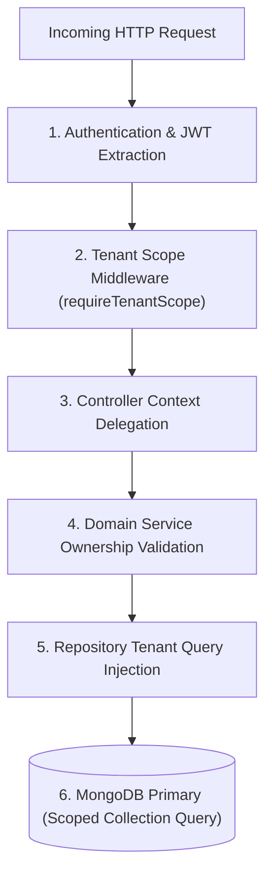

# 05. Multi-Tenant Data Isolation & BOLA/IDOR Security

This document details the multi-tenant isolation architecture, boundary defenses, and Broken Object Level Authorization (BOLA/IDOR) mitigations implemented across the **Theatre & Branch Management Module**.

---

## 1. Threat Model & Tenancy Boundaries

In a multi-tenant cinema SaaS environment, multiple rival cinema chains (e.g., PVR INOX, Cinepolis, MovieMax) operate concurrently on shared cloud infrastructure.

### Critical Threat Vectors:
1. **Broken Object Level Authorization (BOLA / IDOR)**: An authenticated owner of Chain A attempts to read or mutate a cinema record belonging to Chain B by substituting its 24-character BSON `ObjectId` in URL parameters (`/api/v1/owner/theatres/:theatreBId`).
2. **Tenant Privilege Escalation**: An attacker attempts to create branches or auditoriums attached to a competitor's flagship property.
3. **Information Disclosure via Error Timing/Codes**: Leaking whether a competitor's theatre exists by returning `403 Forbidden` rather than generic `404 Not Found`.

---

## 2. Multi-Tiered Isolation Architecture

Isolation is enforced across all architectural layers, ensuring that no single mistake in a controller can breach tenant boundaries:



### 2.1 Layer 1: Cryptographic Authentication
- The access token JWT payload contains immutable claims:
  ```json
  {
    "sub": "65f1a2b3c4d5e6f7a8b9c0u1",
    "role": "THEATRE_OWNER",
    "partnerId": "65f1a2b3c4d5e6f7a8b9c0p1",
    "sid": "65f1a2b3c4d5e6f7a8b9c0s1"
  }
  ```
- Any client attempts to supply `ownerId` or `partnerId` in request bodies or query strings are ignored.

### 2.2 Layer 2: Service-Level Tenant Ownership Verification
Every operation touching a specific theatre record verifies that the entity belongs to `userContext.partnerId`:

```javascript
// From apps/backend/src/modules/theatres/theatre.service.js
const existing = await TheatreRepository.findByIdAndPartnerId(theatreId, userContext.partnerId);
if (!existing) {
  throw new NotFoundError(
    `Theatre not found with ID '${theatreId}' under your organization`,
    ErrorCodes.THEATRE_NOT_FOUND
  );
}
```

### 2.3 Layer 3: Repository-Level Scoped Queries
The repository injects tenant constraints into every database query:

```javascript
// From apps/backend/src/modules/theatres/theatre.repository.js
static async updateWithPartner(theatreId, partnerId, updateData) {
  return Theatre.findOneAndUpdate(
    { _id: theatreId, partnerId, isDeleted: false },
    { $set: updateData },
    { new: true, runValidators: true }
  ).exec();
}
```

Even if an attacker crafts an update for `theatreBId`, the MongoDB query matches **0 documents** because `partnerId` does not match, rendering the attack harmless.

---

## 3. Anti-Enumeration & BOLA Mitigation Matrix

| Scenario | Attacker Input | Conventional Flawed Behavior | Our Secure Behavior |
| :--- | :--- | :--- | :--- |
| **Owner A requests Owner B theatre** | `GET /owner/theatres/<theatreBId>` | Returns `403 Forbidden` (Confirms theatre exists). | **`404 Not Found`** (`THEATRE_NOT_FOUND`). Zero disclosure of competitor's existence. |
| **Owner A updates Owner B theatre** | `PATCH /owner/theatres/<theatreBId>` | Updates competitor's record or throws unhandled error. | **`404 Not Found`**. No mutation occurs. |
| **Owner A deletes Owner B theatre** | `DELETE /owner/theatres/<theatreBId>` | Deletes competitor's cinema. | **`404 Not Found`**. No soft-deletion occurs. |
| **Owner A creates branch under Owner B** | `POST /owner/theatres/<theatreBId>/branches` | Creates illegitimate child branch. | **`404 Not Found`** on parent lookup. Branch rejected. |
| **Super Admin accesses any theatre** | `GET /admin/theatres/<anyId>` | Bypasses tenant boundary with full audit logging. | **`200 OK`**. Global visibility granted for platform compliance. |

---

## 4. Automated Verification Results

This security model is validated by dedicated automated integration tests in:
```text
apps/backend/tests/integration/theatre-owner-isolation.test.js
```
- Verified: Owner A cannot view Owner B's theatre (`404 Not Found`).
- Verified: Owner A cannot mutate Owner B's theatre metadata (`404 Not Found`).
- Verified: Owner A cannot soft-delete Owner B's cinema property (`404 Not Found`).
- Verified: Owner A cannot attach branches to Owner B's cinema (`404 Not Found`).
- Verified: Owner B can seamlessly access their own properties (`200 OK`).

